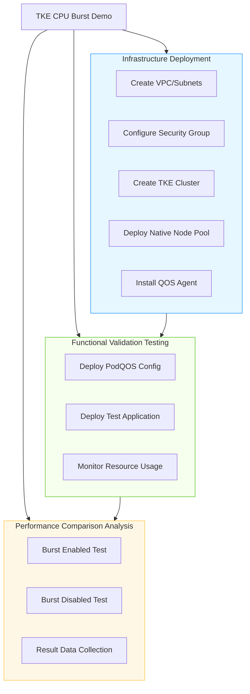
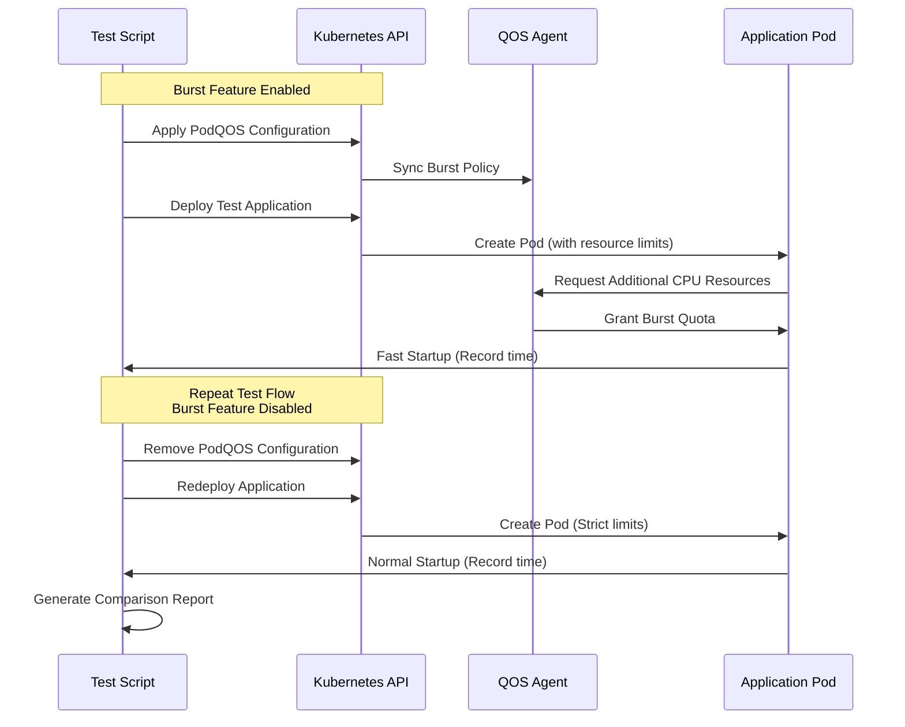

[English](README.md) | [中文](README_zh.md)

### Background & Necessity

Traditional Kubernetes resource management employs a rigid `requests` and `limits` mechanism, which constrains applications' burst performance needs. Applications like Java require higher CPU resources during startup phases, but their resource demands decrease significantly after stabilization. Fixed quotas lead to:
- ​**Startup Performance Bottlenecks**: Slow application startup, negatively impacting user experience.
- ​**Low Resource Utilization**: Over-provisioning resources to meet peak demands, resulting in waste.
- ​**Lack of Elasticity**: Inability to handle unexpected traffic spikes and computational demands.

CPU Burst technology addresses this through intelligent quota management, allowing applications to temporarily exceed preset limits. This ensures stability during normal operation while satisfying burst performance requirements.

### Practical Significance

This demonstration project deeply explores the CPU Burst capability of TKE native nodes, showcasing how to provide Java-based applications with:
- ​**Elastic Resource Allocation**: Automatically acquire additional CPU resources during startup to accelerate the process.
- ​**Cost Efficiency Optimization**: Avoid permanently reserving resources for short-lived high-load moments.
- ​**Seamless Experience Upgrade**: Achieve performance improvements without modifying application code.

### Project Core Value

- ​**Performance Boost**: Significant reduction in Java application startup time (measured improvement of 16.07%).
- ​**Resource Optimization**: On-demand use of burst resources, improving overall cluster utilization.
- ​**Non-Invasive Integration**: Configured via PodQOS CRD, requiring no changes to application deployment configurations.
- ​**Complete Validation System**: Includes comparative test scripts and data verification to quantitatively demonstrate the Burst effect.

### 📊  Deployment Architecture Overview



### 📡 业务访问链路设计


### 🛠  Prerequisites

- ​**Tencent Cloud Account**: Sub-account requires the following permissions:
     - `QcloudTKEAccess` (TKE Access Permission)
	- `QcloudVPCFullAccess` (VPC Full Access Permission)
- ​**Access Keys**: Prepare Tencent Cloud SecretId and SecretKey.
- ​**Region Selection**: Use a region that supports Native Nodes and the CPU Burst feature.- Recommended region: `ap-nanjing` (Nanjing).
- ​**Resource Quotas**: Ensure sufficient quotas are available to create:- VPC and subnet resources.
	- At least 2 CVM instance quotas.
	- TKE cluster resources.
### 🚀  Quick Start

#### Step 1: Container Infrastructure Setup

```
# Execute infrastructure deployment script
./infra/deploy_infra.sh
```

- **Expected Output**:

```
Outputs:

===== TKE Infrastructure Deployment Started =====
Please enter Tencent Cloud SecretId: ********************
Please enter Tencent Cloud SecretKey: ********************

Terraform initialized successfully!
...
Apply complete! Resources: 12 added, 0 changed, 0 destroyed.

===== TKE Infrastructure Deployment Complete =====
Cluster ID: cls-xxxxxx
Cluster Name: tke-cpu-burst-abc123
VPC ID: vpc-xxxxxx
Subnet ID: subnet-xxxxxx
kubeconfig file generated: kubeconfig.yaml
```


####  Step 2: CPU Burst Enabled Test

```
# Execute Burst enabled test script
./burst-on_test.sh
```

-  ​**Expected Output**:

```
===== CPU Burst Enabled Test =====
[i] Applying PodQOS configuration: podqos-burst.yaml
[✓] PodQOS configuration deployed successfully
[i] Deploying test application: burst-on_test.yaml
[✓] Application deployed successfully
[i] Waiting for Pod to become ready...
[✓] Pod is ready: tomcat-abc123
[i] Monitoring startup logs...
[✓] Test completed (Startup time: 1598ms)
```


#### Step 3: CPU Burst Disabled Test

```
# Execute Burst disabled test script
./burst-off_test.sh
```

- **Expected Output**:

```
===== CPU Burst Disabled Test =====
[i] Deploying test application: burst-off_test.yaml
[✓] Application deployed successfully
[i] Waiting for Pod to become ready...
[✓] Pod is ready: tomcat-def456
[i] Monitoring startup logs...
[✓] Test completed (Startup time: 1904ms)
```


#### Step 4: Environment Cleanup

```
# Execute resource cleanup script
./destroy-infra.sh
```

- **Expected Output**:

```
===== Destroying TKE Infrastructure =====
Warning: This will delete all related resources!
...
Destroy complete! Resources: 12 destroyed.
===== Resources Successfully Cleaned Up =====
```

### ⚙️  Example Exercise Environment Configurations

#### Configuration 1: PodQOS CPU Burst Configuration
```
# podqos-burst.yaml
apiVersion: ensurance.crane.io/v1alpha1
kind: PodQOS
metadata:
  name: burst
spec:
  labelSelector:
    matchLabels:
      app: tomcat
  resourceQOS:
    cpuQOS:
      cpuBurst:
        burstQuota: "4.0"
```

#### ### Configuration 2: Test Application (Burst Enabled)

```
# burst-on_test.yaml
apiVersion: apps/v1
kind: Deployment
metadata:
  name: tomcat
  namespace: tomcat-test
spec:
  template:
    spec:
      containers:
      - name: tomcat
        image: tomcat:latest
        resources:
          limits:
            cpu: "0.1"  # Strict limit: 0.1 core
            memory: "1Gi"
          requests:
            cpu: "0.1"
            memory: "1Gi"
  ```
  
#### Configuration 3: Test Application (Burst Disabled)

```
# burst-off_test.yaml
apiVersion: apps/v1
kind: Deployment
metadata:
  name: tomcat
  namespace: tomcat-test
spec:
  template:
    spec:
      containers:
      - name: tomcat
        image: tomcat:latest
        resources:
          limits:
            cpu: "0.1"
            memory: "1Gi"
          requests:
            cpu: "0.1"
            memory: "1Gi"
```

### 📂  Project Structure
```
tke-cpu-burst-demo/
├── deploy-infra.sh           # Infrastructure deployment script
├── destroy-infra.sh          # Resource cleanup script
├── burst-on_test.sh          # Burst enabled test script
├── burst-off_test.sh         # Burst disabled test script
├── variables.tf              # Terraform variable definitions
├── outputs.tf                # Terraform output definitions
├── main.tf                   # Main Terraform configuration
├── podqos-burst.yaml         # PodQOS Burst configuration
├── burst-on_test.yaml        # Test application deployment (Burst enabled)
├── burst-off_test.yaml       # Test application deployment (Burst disabled)
└── README_zh.md              # Chinese documentation
└── README.md                 # English documentation (This file)
```
