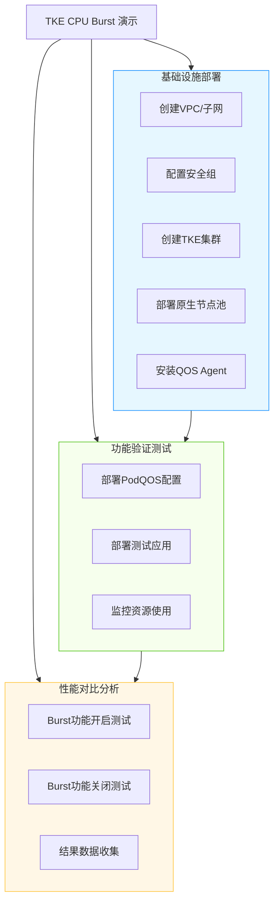
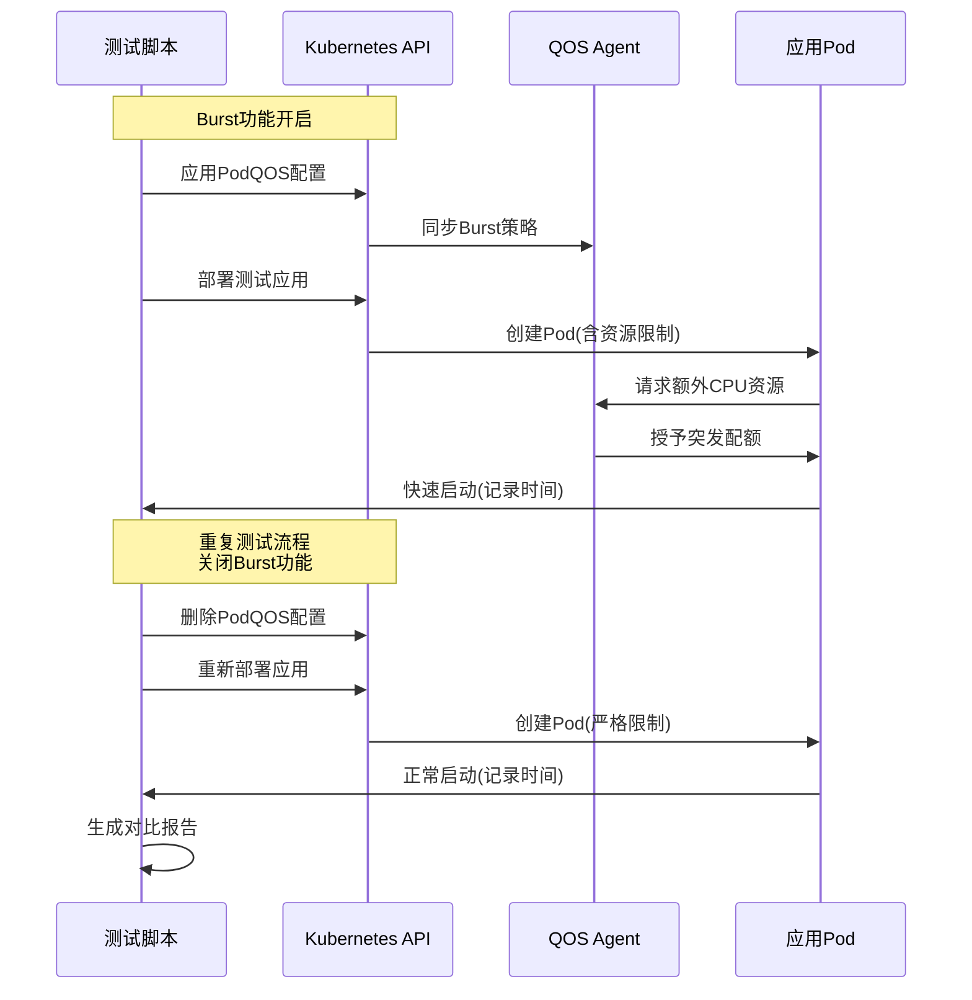

### 背景与必要性

传统 Kubernetes 资源管理采用严格的 `requests` 和 `limits` 机制，限制了应用的突发性能需求。Java 等应用在启动阶段需要较高的 CPU 资源，但稳定运行后资源需求降低，固定配额导致：
- ​**启动性能瓶颈**​：应用启动缓慢，影响用户体验
- ​**资源利用率低**​：为满足峰值需求而过度配置资源，造成浪费
- ​**弹性能力缺失**​：无法应对突发流量和计算需求

CPU Burst 技术通过智能配额管理，允许应用临时超过预设限制，既保障了常规运行的稳定性，又满足了突发性能需求。
### 实践意义

本演示项目深入探索 TKE 原生节点的 CPU Burst 能力，展示如何为 Java 类应用提供：
- ​**弹性资源分配**​：应用启动时自动获取额外 CPU 资源，加速启动过程
- ​**成本效益优化**​：避免为短暂的高负载时刻永久预留资源
- ​**无缝体验升级**​：无需修改应用代码即可获得性能提升

### 项目核心价值

- ​**性能提升**​：Java 应用启动时间显著缩短（实测提升 16.07%）
- ​**资源优化**​：按需使用突发资源，提高整体资源利用率
- ​**无侵入集成**​：通过 PodQOS CRD 配置，无需修改应用部署配置
- ​**完整验证体系**​：提供对比测试脚本数据验证，量化展示 Burst 效果

### 📊 部署架构全景



### 📡 业务访问链路设计


### 🛠 前提条件

- ​**腾讯云账号**​：子账号需具备以下权限
	- `QcloudTKEAccess` TKE 访问权限
	- `QcloudVPCFullAccess` VPC 全访问权限
- ​**访问密钥**​：准备腾讯云 SecretId 和 SecretKey
- ​**地域选择**​：支持原生节点和 CPU Burst 功能的区域
	- 推荐使用 `ap-nanjing`（南京）区域
- ​**资源配额**​：确保有足够的资源配额创建
	- VPC 和子网资源
	- 至少 2 个 CVM 实例额度
	- TKE 集群资源

### 🚀 快速开始

#### 步骤1：容器基础设施搭建

```
# 执行基础设施部署脚本
./infra/deploy_infra.sh
```

- 预期输出结果​：

```
Outputs:

===== TKE 基础设施部署开始 =====
请输入腾讯云SecretId: ********************
请输入腾讯云SecretKey: ********************

Terraform initialized successfully!
...
Apply complete! Resources: 12 added, 0 changed, 0 destroyed.

===== TKE基础设施部署完成 =====
集群ID: cls-xxxxxx
集群名称: tke-cpu-burst-abc123
VPC ID: vpc-xxxxxx
子网ID: subnet-xxxxxx
kubeconfig文件已生成: kubeconfig.yaml
```


#### 步骤2：CPU Burst 开启测试

```
# 执行Burst开启测试脚本
./burst-on_test.sh
```

- 预期输出结果​：

```
===== CPU Burst开启测试 =====
[i] 应用PodQOS配置: podqos-burst.yaml
[✓] PodQOS配置部署成功
[i] 部署测试应用: burst-on_test.yaml
[✓] 应用部署成功
[i] 等待Pod就绪...
[✓] Pod已就绪: tomcat-abc123
[i] 监控启动日志...
[✓] 测试完成 (启动时间: 1598ms)
```


#### 步骤3：CPU Burst 关闭测试

```
# 执行Burst关闭测试脚本
./burst-off_test.sh
```

- 预期输出结果​：

```
===== CPU Burst关闭测试 =====
[i] 部署测试应用: burst-off_test.yaml
[✓] 应用部署成功
[i] 等待Pod就绪...
[✓] Pod已就绪: tomcat-def456
[i] 监控启动日志...
[✓] 测试完成 (启动时间: 1904ms)
```


#### 步骤4：环境清理

```
# 执行资源清理脚本
./destroy-infra.sh
```

- 预期输出结果​：

```
===== 销毁TKE基础设施 =====
警告: 这将删除所有相关资源!
...
Destroy complete! Resources: 12 destroyed.
===== 资源已成功清理 =====
```

### ⚙️ 演练环境配置举例说明

#### 配置1：PodQOS CPU Burst 配置​**:
```
# podqos-burst.yaml
apiVersion: ensurance.crane.io/v1alpha1
kind: PodQOS
metadata:
  name: burst
spec:
  labelSelector:
    matchLabels:
      app: tomcat
  resourceQOS:
    cpuQOS:
      cpuBurst:
        burstQuota: "4.0"
```

#### 配置2：开启Burst测试应用

```
# burst-on_test.yaml
apiVersion: apps/v1
kind: Deployment
metadata:
  name: tomcat
  namespace: tomcat-test
spec:
  template:
    spec:
      containers:
      - name: tomcat
        image: tomcat:latest
        resources:
          limits:
            cpu: "0.1"  # 严格限制：0.1核
            memory: "1Gi"
          requests:
            cpu: "0.1"
            memory: "1Gi"
  ```
  
#### 配置3：关闭Burst测试应用

```
# burst-off_test.yaml
apiVersion: apps/v1
kind: Deployment
metadata:
  name: tomcat
  namespace: tomcat-test
spec:
  template:
    spec:
      containers:
      - name: tomcat
        image: tomcat:latest
        resources:
          limits:
            cpu: "0.1"
            memory: "1Gi"
          requests:
            cpu: "0.1"
            memory: "1Gi"
```

### 📂 项目结构
```
tke-cpu-burst-demo/
├── deploy-infra.sh           # 基础设施部署脚本
├── destroy-infra.sh          # 资源清理脚本
├── burst-on_test.sh          # Burst开启测试脚本
├── burst-off_test.sh         # Burst关闭测试脚本
├── variables.tf              # Terraform变量定义
├── outputs.tf                # Terraform输出定义
├── main.tf                   # 主要Terraform配置
├── podqos-burst.yaml         # PodQOS Burst配置
├── burst-on_test.yaml        # 测试应用部署（Burst开启）
├── burst-off_test.yaml       # 测试应用部署（Burst关闭）
└── README_zh.md              # 中文说明文档
└── README.md                 # 英文说明文档
```
